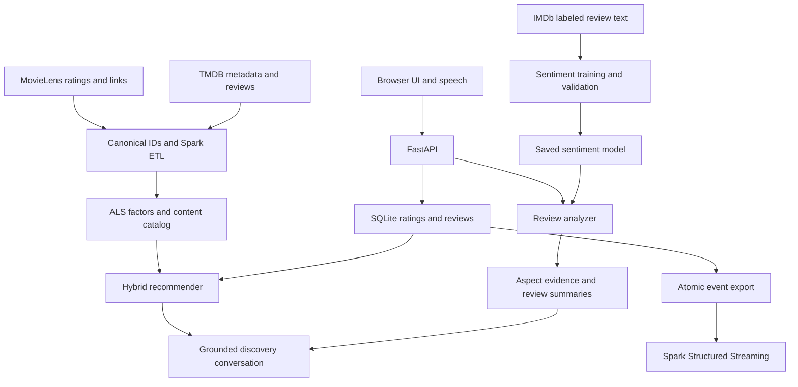

# Architecture and design choices

## Live and batch inference

The backend uses a single `ReviewAnalyzer` for new submissions, stored review summaries and JSONL processing. It prefers a locally fine-tuned sentiment transformer, then a local TF-IDF model, then a transparent lexicon fallback. Explicitly requested missing models fail early instead of silently changing the model. Model files are loaded only from local trusted paths. Pickled scikit-learn artifacts should come from your own trusted training process.

Aspect extraction first identifies sentences/clauses mentioning an aspect. With a trained aspect model, it scores `(aspect,text)` pairs; otherwise it applies the active binary sentiment method to the clause. It does not fully solve implicit aspect sentiment, sarcasm, pronoun resolution or multiple opposing aspects within a single clause. Those require annotated evaluation and improved ABSA extraction. Null scores are retained when evidence is missing or uncertain.

Genre/theme relevance is the share of clauses mentioning taxonomy aliases, with evidence. This is distinct from sentiment about an aspect and from metadata membership. It is intentionally not described as a calibrated multi-label classifier.

## Integrity and summarization

The full summary iterates all stored reviews for the movie, removes later exact/near duplicate entries, excludes high-risk screened entries and records the reasons/counts. It averages per-review aspect values, counts positive, negative, mixed, neutral and low-confidence reviews, and selects diverse positive and negative excerpts with review IDs. It does not say a small sample is a public consensus, and it does not fabricate sentiment for new movies.

Near-duplicate screening compares texts with `SequenceMatcher`; it is suitable for the local sample and moderate movie populations, not billion-review deduplication. At scale replace this stage with MinHash/LSH candidate generation and a source-ID hash index in the batch layer. The summary's eligible population and exclusions must be reported.

## Personalized retrieval

Features: repeated genre/theme tokens + synopsis TF-IDF with unigrams and bigrams. The user vector is a recency-weighted sum of movie vectors with signed strength `(rating - 3)`. This uses likes and dislikes, not only frequencies.

For known ALS items, item vectors form matrix `Y`. Live user fold-in solves `(YᵀY + λ n I)x = Yᵀr`, consistent with a regularized explicit-rating objective. Weighted collaborative and content signals are ranking scores, not enjoyment probabilities. Seen items are excluded; genre/theme UI constraints use intersection; MMR-like reranking penalizes redundant content in a bounded candidate set.

The implemented hybrid weights are starting hyperparameters, not tuned claims. Select weights with validation data. A new item uses content; a new user receives exploration. Embedding retrieval is enabled only by an explicit local sentence-transformer path. Loading a real ALS factor table with the demo ID namespace is prevented.

## Conversation and speech

A deterministic parser carries genres, themes, exclusions, runtime and last movie through explicit context JSON. The canonical catalog supplies title cards. Movie review summaries read stored evidence by movie ID. An optional T5 model can add experimental wording over the retrieved facts; it does not choose arbitrary titles or replace evidence-based summaries. This constrained discovery assistant is not a general-purpose film knowledge chatbot.

Browser speech writes a transcript into the compose box. The optional Whisper API accepts at most 10 MiB of streamed audio and uses a local downloaded model; recordings are not retained by this endpoint. The browser recorder stops after 30 seconds. Text input is the fallback.

## Deployment boundary

The hosted preview is a static UI demonstration with browser-local data. The downloadable frontend detects the colocated `/api/health` endpoint and automatically uses the Python backend when served by FastAPI. There is no hidden remote API and no secret in the browser bundle.

SQLite + a process lock suit an academic/local app. A larger deployment needs authenticated identities, database ownership checks, a background inference/summary queue, durable external storage, batching, model monitoring, and a proper approximate-nearest-neighbor index. Spark handles offline/distributed work, not every interactive HTTP request. These upgrades are not silently claimed to exist here.
