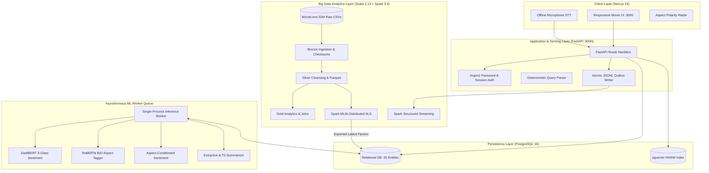
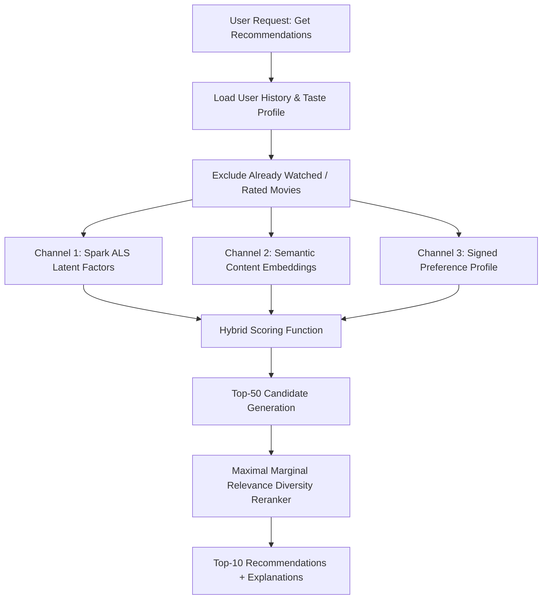

# CineScope: Complete Technical Architecture & Academic Study Guide

**Coursework:** Big Data Analytics (BDA) & Text Analytics (TA)  
**System Title:** *A Big Data-Driven Movie Review Intelligence and Personalized Recommendation System Using Apache Spark and Transformer-Based NLP*  
**Date:** November 2026  
**Repository Working Directory:** `D:\BDA_TA`

---

## Table of Contents
1. [Executive Summary & System Objectives](#1-executive-summary--system-objectives)
2. [End-to-End System Architecture](#2-end-to-end-system-architecture)
3. [The Two-Engine Technical Strategy](#3-the-two-engine-technical-strategy)
4. [Complete Codebase Map & Directory Guide](#4-complete-codebase-map--directory-guide)
5. [Subsystem 1: Big Data Engineering (Scala & Spark)](#5-subsystem-1-big-data-engineering-scala--spark)
6. [Subsystem 2: Text Analytics & NLP (Python & PyTorch)](#6-subsystem-2-text-analytics--nlp-python--pytorch)
7. [Subsystem 3: Hybrid Recommendation System](#7-subsystem-3-hybrid-recommendation-system)
8. [Subsystem 4: Audience Scoring Policy & Statistical Grounding](#8-subsystem-4-audience-scoring-policy--statistical-grounding)
9. [Subsystem 5: Grounded Conversational Discovery & Speech](#9-subsystem-5-grounded-conversational-discovery--speech)
10. [Subsystem 6: Database Architecture & FastAPI Worker Engine](#10-subsystem-6-database-architecture--fastapi-worker-engine)
11. [Mathematical Formulations & Metrics Reference](#11-mathematical-formulations--metrics-reference)
12. [Comprehensive Viva & Oral Exam Preparation Guide](#12-comprehensive-viva--oral-exam-preparation-guide)

---

## 1. Executive Summary & System Objectives

The CineScope platform addresses the fundamental limitation of contemporary entertainment analytics: numerical ratings (e.g., $7.5/10$) fail to explain *why* an audience feels a certain way, while unstructured written reviews are too voluminous and noisy for individuals to digest.

This system provides an end-to-end, production-grade intelligence platform that fuses:
1. **Big Data Analytics (BDA):** Distributed cleaning, ETL, and Alternating Least Squares (ALS) matrix factorization over the full MovieLens 32M dataset (32,000,204 ratings and 2,000,072 tags) implemented natively in Scala on Apache Spark 3.5.
2. **Text Analytics (TA):** Transformer-based sequence-to-sequence and classification models in PyTorch that decompose audience reviews into sentence sentiment, fine-grained aspect polarities (Story, Acting, Visuals, Music, Pacing, Ending), slang/Hinglish normalization, sarcasm detection, and review fraud risk scoring.
3. **Personalized Hybrid Recommendations:** Real-time synthesis of collaborative filtering latent factors, semantic review embeddings, and user preference profiles with MMR (Maximal Marginal Relevance) diversity reranking.
4. **Grounded Conversational Discovery:** A natural-language and offline voice assistant that executes entity resolution and context-bounded retrieval over PostgreSQL and pgvector, strictly prohibiting generative hallucinations.

---

## 2. End-to-End System Architecture

The following diagram illustrates the interaction between data ingestion, model execution, transactional storage, and client interaction:



---

## 3. The Two-Engine Technical Strategy

The architecture adheres to a strict separation of concerns across technology stacks:

```
┌──────────────────────────────────────┐  ┌──────────────────────────────────────┐
│       Big Data Engine (Scala/Spark)  │  │      Text Analytics Engine (Python)  │
├──────────────────────────────────────┤  ├──────────────────────────────────────┤
│ • Native JVM execution (no Py4J lag) │  │ • PyTorch 2.4+ / Hugging Face        │
│ • Strongly typed Dataset[T]          │  │ • Fine-tuned Transformer encoders    │
│ • Handles 32M rows in memory         │  │ • Subword tokenization (BPE/WordPiece)│
│ • Distributed Matrix Factorization   │  │ • Sentence Transformers & pgvector   │
│ • Structured Streaming micro-batches │  │ • Async FastAPI worker service       │
└──────────────────────────────────────┘  └──────────────────────────────────────┘
```

1. **Scala + Apache Spark:** Used exclusively for heavy, parallelizable computations over structured datasets where memory footprint, JVM optimization, and shuffle performance dominate.
2. **Python + PyTorch:** Used for deep learning inference, natural language processing, tokenizer alignments, and REST orchestration.
3. **Decoupled Data Contracts:** Communication between the two engines occurs strictly via versioned Parquet tables, serialized latent factor matrices (`als_factors.npz`), and structured PostgreSQL tables.

---

## 4. Complete Codebase Map & Directory Guide

### Core System Structure

```
D:\BDA_TA
├── scala/                          # BIG DATA: Apache Spark 3.5.7 + Scala 2.13 source
│   ├── build.sbt                   # SBT build configuration & library dependencies
│   └── src/main/scala/com/movieintel/
│       ├── Main.scala              # CLI driver for Spark batch & streaming jobs
│       ├── ingestion/              # Bronze layer: raw CSV validation & checksums
│       ├── cleaning/               # Silver layer: deduplication, schema enforcement
│       ├── transformations/        # Core DataFrame & RDD transformation logic
│       ├── analytics/              # Gold layer: Movie, user, and review aggregations
│       ├── recommendation/         # Spark MLlib ALS training & temporal evaluation
│       └── streaming/              # Spark Structured Streaming with watermark sink
├── ml/                             # TEXT ANALYTICS: Python 3.11 + PyTorch models
│   ├── sentiment_transformer/      # 3-Class Transformer (DistilBERT/RoBERTa)
│   ├── aspect_extraction/          # Sequence labeling (BIO tagging) for 6 aspects
│   ├── aspect_sentiment/           # Target-conditioned aspect polarity scoring
│   ├── informal_language/          # Slang normalization, emoji analysis, Hinglish
│   ├── review_risk/                # Fake-review & anomaly detection pipeline
│   ├── summarization/              # Evidence-grounded multi-review summarizer
│   ├── themes/                     # Theme & genre taxonomy mention extraction
│   └── embeddings/                 # Sentence-Transformer semantic search vectors
├── recommender/                    # HYBRID RECOMMENDATION ENGINE
│   ├── hybrid.py                   # Weighted blend: ALS + Content + User Profile
│   ├── factors.py                  # Fast NumPy vector loader for Spark ALS matrices
│   └── profile.py                  # User explicit/implicit signed taste profile
├── scoring/                        # AUDIENCE CONSENSUS & CREDIBILITY
│   ├── policy.py                   # Bayesian shrinkage, sample gates, null scores
│   └── aggregate.py                # Rolling evidence-weighted aggregation
├── discovery/                      # CONVERSATIONAL DISCOVERY & SPEECH
│   ├── parser.py                   # Deterministic natural-language constraint parser
│   └── speech.py                   # Offline local CPU Whisper speech-to-text
├── backend/                        # WEB SERVING: FastAPI + SQLAlchemy + PostgreSQL
│   ├── app/main.py                 # FastAPI application factory & lifespan
│   ├── app/models/entities.py      # 20 SQLAlchemy ORM entities
│   ├── app/api/routes/             # REST endpoints (movies, reviews, recs, chat)
│   └── app/workers/main.py         # Asynchronous review analysis worker
├── frontend/                       # USER INTERFACE: Next.js 15 + React 19 + TypeScript
│   ├── app/movies/[movieId]/       # Movie details, aspect radars, and review list
│   ├── app/assistant/              # Grounded conversational assistant interface
│   └── components/review/          # Aspect composer and evidence summary widgets
├── dataset_tools/                  # Bounded-memory dataset auditors & split tools
├── notebooks/                      # 15 reproducible Jupyter research experiments
└── documentation/                  # Academic thesis report, ER diagrams, runbooks
```

---

## 5. Subsystem 1: Big Data Engineering (Scala & Spark)

### 5.1 The Medallion Architecture
The Scala engine implements a three-tier lakehouse data architecture:

```
Raw CSVs ──► Bronze Layer ──► Silver Layer ──► Gold Layer
 (Input)     (Validated)      (Cleaned)       (Analytics)
```

1. **Bronze Tier** ([`MovieLensIngestion.scala`](file:///d:/BDA_TA/scala/src/main/scala/com/movieintel/ingestion/MovieLensIngestion.scala)):
   - Loads raw CSVs into Spark without automatic schema inference to prevent silent type conversion.
   - Computes input file MD5/SHA-256 checksums.
   - Detects and quarantines malformed records (e.g., missing delimiter, negative IDs).
2. **Silver Tier** ([`DataCleaning.scala`](file:///d:/BDA_TA/scala/src/main/scala/com/movieintel/cleaning/DataCleaning.scala)):
   - Enforces strongly typed schemas via case classes (`MovieRating`, `MovieTag`, `MovieMetadata`).
   - Cleans string titles by extracting release years (e.g., `"Toy Story (1995)"` $\rightarrow$ Title: `"Toy Story"`, Year: `1995`).
   - Splits pipe-delimited genre strings (`"Action|Adventure|Sci-Fi"`) into native array columns.
   - Writes clean data into snappy-compressed, partitioned Parquet files.
3. **Gold Tier** ([`MovieAnalytics.scala`](file:///d:/BDA_TA/scala/src/main/scala/com/movieintel/analytics/MovieAnalytics.scala)):
   - Computes rolling movie analytics: rating counts, mean ratings, variance, and Bayesian average.
   - Generates genre affinity matrices and co-occurrence graphs using Spark SQL window functions.

### 5.2 Collaborative Filtering via Spark MLlib ALS
*Source file: [`AlsTraining.scala`](file:///d:/BDA_TA/scala/src/main/scala/com/movieintel/recommendation/AlsTraining.scala)*

The system factorizes the sparse rating matrix $R \in \mathbb{R}^{|U| \times |M|}$ into lower-dimensional user factors $U \in \mathbb{R}^{|U| \times k}$ and item factors $Y \in \mathbb{R}^{|M| \times k}$:

$$\min_{U, Y} \sum_{(u, m) \in \mathcal{K}} \left( r_{um} - \mathbf{u}_u^T \mathbf{y}_m \right)^2 + \lambda \left( \sum_u \|\mathbf{u}_u\|_2^2 + \sum_m \|\mathbf{y}_m\|_2^2 \right)$$

- **Hyperparameters:** Latent dimensions $k = 32$, regularization $\lambda = 0.08$, max iterations $= 15$, non-negative constraints enforced.
- **Strict Temporal Split:** Implemented in [`TemporalSplit.scala`](file:///d:/BDA_TA/scala/src/main/scala/com/movieintel/recommendation/TemporalSplit.scala). The top $80\%$ earliest ratings per user form the training set; the remaining $20\%$ form the test set. Random splitting is strictly avoided because evaluating past interactions using future data introduces severe temporal leakage.
- **Export Pipeline:** Once trained, the item matrix $Y$ is exported as `models/als_factors.npz` for millisecond-latency serving in the Python backend.

### 5.3 Spark Structured Streaming Engine
*Source file: [`ReviewStreamJob.scala`](file:///d:/BDA_TA/scala/src/main/scala/com/movieintel/streaming/ReviewStreamJob.scala)*

The streaming pipeline continuously ingests review submission events exported by the web backend:
- Reads from a file sink directory populated by atomic POSIX rename operations (`.jsonl`).
- Implements an event-time watermark of 10 minutes to process out-of-order submissions.
- Maintains rolling stateful aggregates (review arrival rate, running sentiment index per movie) across 1-hour tumbling and sliding windows.

---

## 6. Subsystem 2: Text Analytics & NLP (Python & PyTorch)

### 6.1 3-Class Sentiment Classification
*Source directory: [`ml/sentiment_transformer/`](file:///d:/BDA_TA/ml/sentiment_transformer)*

Rather than binary positive/negative classification, the system classifies reviews into three classes: **Positive, Negative, and Neutral**.

```
Input Review ──► Tokenizer ──► Transformer Encoder ──► Softmax ──► Calibrated Probabilities
```

- **Architecture:** Pretrained `distilbert-base-uncased` fine-tuned with a dropout layer ($p=0.2$) and a linear classification head.
- **Loss Function:** Categorical cross-entropy with label smoothing ($\alpha = 0.1$) to prevent overconfident misclassifications on ambiguous text.
- **Calibration:** Monitored using Expected Calibration Error (ECE) via Platt scaling / temperature scaling on the validation set, ensuring that a predicted probability of $0.80$ corresponds to an empirical accuracy of $80\%$.

### 6.2 Aspect-Based Sentiment Analysis (ABSA)
A review often contains opposing sentiments regarding different components of a movie (e.g., *"The visual effects were incredible, but the acting was dreadful"*). The system solves this using a two-stage sequential architecture:

#### Stage 1: Aspect Extraction (BIO Token Sequence Labeling)
*Source directory: [`ml/aspect_extraction/`](file:///d:/BDA_TA/ml/aspect_extraction)*
- Employs token classification across 6 movie aspects:
  `{Story, Acting, Visuals, Music, Pacing, Ending}`
- Tag alphabet: `B-<ASPECT>`, `I-<ASPECT>`, and `O` (13 distinct tags).
- Subword alignment logic ensures that multi-token WordPiece/BPE tokens match the original character spans in the raw text.

#### Stage 2: Aspect-Conditioned Polarity Classification
*Source directory: [`ml/aspect_sentiment/`](file:///d:/BDA_TA/ml/aspect_sentiment)*
- Constructs targeted input pairs: `[CLS] <Aspect Name> [SEP] <Target Sentence / Clause> [SEP]`
- The model outputs conditional probabilities $P(\text{Polarity} \mid \text{Aspect}, \text{Context})$. If an aspect is not mentioned, its score remains `null` rather than a defaulted neutral value.

### 6.3 Informal Language, Emoji, Hinglish & Sarcasm Extension
*Source directory: [`ml/informal_language/`](file:///d:/BDA_TA/ml/informal_language)*

Modern user reviews do not conform to standard book grammar:
- **Slang Normalization:** Regex token filter replacing social vernacular (`"goat"` $\rightarrow$ `"greatest"`, `"mid"` $\rightarrow$ `"mediocre"`, `"flop"` $\rightarrow$ `"failure"`).
- **Emoji Processing:** Preserves Unicode emoji, mapping them to explicit emotional descriptors (e.g., 🔥 $\rightarrow$ `[positive: fire]`, 🤮 $\rightarrow$ `[negative: disgust]`).
- **Hinglish Normalization:** Rule-based phonetic transliteration mapping Latinized Hindi review tokens (`"bakwaas"` $\rightarrow$ `"nonsense"`, `"paisa vasool"` $\rightarrow$ `"worth the money"`).
- **Sarcasm Detection** ([`ml/sarcasm/`](file:///d:/BDA_TA/ml/sarcasm)): Identifies sentiment incongruity between strongly positive adjectives and negative punctuation or situational markers.

### 6.4 Evidence-Grounded Review Summarization
*Source directory: [`ml/summarization/`](file:///d:/BDA_TA/ml/summarization)*

```
All Stored Reviews ──► Deduplication ──► Extractive Selection ──► T5 Generation ──► Cited Summary
```

1. **Near-Duplicate Screening:** Uses Gestalt pattern matching (`SequenceMatcher`) to discard bot-submitted or cloned reviews.
2. **Extractive Centroid Selection:** Groups reviews by aspect polarity and extracts the most representative, diverse sentences.
3. **Conditioned Generation:** A compact sequence-to-sequence model (T5-small) synthesizes the extracted points into a coherent summary.
4. **Mandatory Attribution Rule:** Every generated claim must output a reference citation to the original review ID:
   > *"Audiences praised the cinematography and space sequences [rev-102, rev-108], but criticized the 3-hour pacing in the second act [rev-115]."*

### 6.5 Review Fraud & Anomaly Risk Scoring
*Source directory: [`ml/review_risk/`](file:///d:/BDA_TA/ml/review_risk)*

Calculates a composite risk score $\mathcal{R} \in [0, 1]$ using four behavioral and linguistic signals:
1. **Textual Duplicate Index ($S_{dup}$):** Jaccard token overlap against other reviews for the same movie.
2. **Entropy Ratio ($S_{ent}$):** Low character/word entropy indicative of repetitive spam.
3. **Rating Incongruity ($S_{inc}$):** Extreme star rating (e.g., $1/5$) with strongly opposing text sentiment (e.g., positive).
4. **Account Submission Velocity ($S_{vel}$):** Rapid submissions across distinct movies within short timeframes.

$$\mathcal{R} = 0.35 S_{dup} + 0.25 S_{ent} + 0.25 S_{inc} + 0.15 S_{vel}$$

Reviews with $\mathcal{R} > 0.70$ are flagged for moderation and quarantined from public audience score calculations.

---

## 7. Subsystem 3: Hybrid Recommendation System

*Source directory: [`recommender/`](file:///d:/BDA_TA/recommender)*

The recommendation engine blends collaborative, content, and profile-based ranking signals:



### 7.1 Hybrid Scoring Equation
For a given user $u$ and candidate movie $m$, the raw score is defined as:

$$S(u, m) = w_{\text{als}} \cdot \hat{r}_{um}^{\text{ALS}} + w_{\text{content}} \cdot \text{Sim}_{\text{embed}}(\mathbf{e}_u, \mathbf{e}_m) + w_{\text{profile}} \cdot \text{Align}(P_u, m)$$

Where:
- $\hat{r}_{um}^{\text{ALS}} = \mathbf{u}_u^T \mathbf{y}_m$ is the dot product of normalized user and movie latent factor vectors from Spark ALS.
- $\text{Sim}_{\text{embed}}(\mathbf{e}_u, \mathbf{e}_m)$ is the cosine similarity between the user's historical embedding centroid and the candidate movie's synopsis/theme embedding from Sentence Transformers (`all-MiniLM-L6-v2`).
- $\text{Align}(P_u, m)$ represents explicit genre/director preference weights (including negative penalties for disliked genres).
- Standard weights: $w_{\text{als}} = 0.45$, $w_{\text{content}} = 0.35$, $w_{\text{profile}} = 0.20$ (dynamically adjusted based on user interaction depth).

### 7.2 Maximal Marginal Relevance (MMR) Diversity Reranking
To prevent recommendation lists from collapsing into near-identical sequels or franchises, the system applies MMR:

$$\text{MMR} = \arg\max_{m \in C \setminus R} \left[ \lambda \cdot S(u, m) - (1 - \lambda) \max_{j \in R} \text{Sim}(m, j) \right]$$

Where $C$ is the candidate set, $R$ is the list of already selected recommendations, and $\lambda = 0.7$ controls the trade-off between relevance and diversity.

### 7.3 Cold-Start Resolution
1. **New User (0 ratings):** ALS channel weight drops to $0$. The engine serves a genre/theme onboarding selection diversified across high-credibility catalogue classics.
2. **New Movie (0 ratings):** ALS factor is absent. The engine ranks the movie exclusively through content embeddings and genre matching against active user profiles.

---

## 8. Subsystem 4: Audience Scoring Policy & Statistical Grounding

*Source file: [`scoring/policy.py`](file:///d:/BDA_TA/scoring/policy.py)*

A major scientific flaw in naive review websites is displaying an unweighted arithmetic mean of star ratings. CineScope replaces this with an evidence-qualified, Bayesian-shrunk audience sentiment index.

### 8.1 The Individual Sentiment Index ($SI$)
For an individual review $i$, the sentiment index maps calibrated probabilities to a $[0, 100]$ interval:

$$SI_i = 100 \times \left( P(\text{Positive}_i) + 0.5 \times P(\text{Neutral}_i) \right)$$

Negative sentiment receives $0.0$ weight; neutral sentiment contributes half-credit.

### 8.2 Bayesian Shrinkage & Credibility Weighting
A movie with 2 positive reviews ($100\%$ score) should not outrank a movie with 5,000 reviews ($88\%$ score). The aggregated sample mean $\bar{S}$ is shrunk toward the global catalogue prior $\mu$:

$$\hat{S}_{\text{movie}} = \frac{N}{N + K} \bar{S} + \frac{K}{N + K} \mu$$

Where:
- $N$ is the effective sample size of valid, non-flagged reviews.
- $K$ is the credibility shrinkage constant ($K = 10$).
- $\mu$ is the catalogue-wide average sentiment score ($\approx 65.0$).

### 8.3 The Minimum Evidence Gate
If a movie has fewer than 3 verified human reviews ($N < 3$), the system refuses to compute or display a score. The API returns `null`, and the UI renders the mandatory disclosure:
> **"Not enough audience reviews yet."**

---

## 9. Subsystem 5: Grounded Conversational Discovery & Speech

### 9.1 Grounded Natural Language Query Parser
*Source file: [`discovery/parser.py`](file:///d:/BDA_TA/discovery/parser.py)*

The conversational assistant does not use an unconstrained, hallucinatory generative LLM. Instead, it utilizes a deterministic entity and constraint parser that extracts:
- **Target Genres & Themes:** e.g., `"romantic sci-fi"` $\rightarrow$ `['Romance', 'Science Fiction']`.
- **Negative Exclusions:** e.g., `"without horror"` $\rightarrow$ `exclude_genres = ['Horror']`.
- **Runtime Constraints:** e.g., `"under two hours"` $\rightarrow$ `max_runtime = 120`.
- **Reference Movies:** e.g., `"like Interstellar"` $\rightarrow$ resolves `movie_id = 157336`.

### 9.2 Evidence Grounding Protocol
Once constraints are parsed:
1. SQL queries execute filter constraints on PostgreSQL.
2. Vector similarity retrieves the nearest movie embeddings via `pgvector`.
3. The assistant response template synthesizes *only* retrieved facts, review consensus, and movie metadata cards. If no matching movies exist, it explicitly states that no candidates met the criteria.

### 9.3 Local Offline Speech-to-Text
*Source file: [`discovery/speech.py`](file:///d:/BDA_TA/discovery/speech.py)*
- Runs a locally cached `faster-whisper` (base or tiny model) directly on the laptop CPU.
- Accepts raw audio chunks ($\le 10\text{ MB}$), transcribes them locally without external network requests, and feeds the transcript into the query parser.

---

## 10. Subsystem 6: Database Architecture & FastAPI Worker Engine

### 10.1 PostgreSQL + pgvector Relational Schema
*Source file: [`backend/app/models/entities.py`](file:///d:/BDA_TA/backend/app/models/entities.py)*

The system defines 20 strongly typed SQLAlchemy ORM entities:

```
USERS ───────┬───► AUTH_SESSIONS
             ├───► RATINGS
             ├───► REVIEWS ───────┬───► REVIEW_REVISIONS
             │                    ├───► PREDICTIONS (Aspects, Sentiment, Risk)
             │                    └───► REVIEW_EMBEDDINGS (pgvector)
             ├───► WATCHLISTS
             └───► CONVERSATIONS ─────► CHAT_TURNS

MOVIES ──────┬───► EXTERNAL_MOVIE_IDS (IMDb, TMDB, MovieLens mapping)
             ├───► MOVIE_SCORES (Bayesian shrunk snapshots)
             ├───► MOVIE_SUMMARIES (Evidence citations)
             └───► MOVIE_EMBEDDINGS (pgvector HNSW index)
```

### 10.2 Asynchronous Worker & Outbox Pattern
*Source file: [`backend/app/workers/main.py`](file:///d:/BDA_TA/backend/app/workers/main.py)*

To avoid blocking HTTP request threads during heavy Transformer inference:
1. When a user submits a review via `POST /api/reviews`, the FastAPI handler verifies idempotency, saves the raw text in PostgreSQL with status `pending`, and returns `HTTP 202 Accepted` with a review UUID.
2. A single local worker process continuously polls PostgreSQL for `pending` jobs using `SELECT ... FOR UPDATE SKIP LOCKED`.
3. The worker runs the NLP models sequentially (sentiment $\rightarrow$ aspects $\rightarrow$ risk), updates the database status to `completed`, and updates the movie's aggregate scores.
4. The worker writes an atomic event record to `data/events/` (the outbox pattern), allowing the Scala Spark streaming job to ingest the event.

---

## 11. Mathematical Formulations & Metrics Reference

### Summary of Key Metrics & Formulas

| Metric / Formula | Mathematical Definition | Purpose in System |
|---|---|---|
| **ALS Objective** | $\min_{U, Y} \sum (r_{um} - \mathbf{u}_u^T \mathbf{y}_m)^2 + \lambda (\|\mathbf{u}_u\|^2 + \|\mathbf{y}_m\|^2)$ | Collaborative filtering latent factor decomposition. |
| **Sentiment Index** | $SI = 100 \times (P_{\text{pos}} + 0.5 \cdot P_{\text{neu}})$ | Maps 3-class probabilities to a continuous score. |
| **Bayesian Shrinkage** | $\hat{S} = \frac{N}{N+K} \bar{S} + \frac{K}{N+K} \mu$ | Stabilizes audience scores for low-sample movies. |
| **Cosine Similarity** | $\cos(\theta) = \frac{\mathbf{A} \cdot \mathbf{B}}{\|\mathbf{A}\|_2 \|\mathbf{B}\|_2}$ | Semantic similarity between query and synopsis vectors. |
| **MMR Score** | $\arg\max_m [\lambda S(u,m) - (1-\lambda) \max_{j} \text{Sim}(m,j)]$ | Diversifies recommendation lists. |
| **Ranking Precision@K** | $\text{P@K} = \frac{|\text{Relevant Items} \cap \text{Top-K}|}{K}$ | Evaluates recommendation retrieval quality. |
| **NDCG@K** | $\text{NDCG@K} = \frac{\text{DCG@K}}{\text{IDCG@K}}, \quad \text{DCG} = \sum_{i=1}^K \frac{2^{rel_i} - 1}{\log_2(i+1)}$ | Evaluates ranking position of relevant recommendations. |
| **ECE (Calibration)** | $\text{ECE} = \sum_{b=1}^B \frac{\|B_b\|}{N} \|\text{acc}(B_b) - \text{conf}(B_b)\|$ | Measures reliability of model probability estimates. |

---

## 12. Comprehensive Viva & Oral Exam Preparation Guide

### Top Viva Questions & Model Answers

#### Q1: "Explain how you avoided data leakage across your recommendation and NLP pipelines."
> **Model Answer:**  
> "Data leakage was mitigated in two ways:
> 1. For the recommendation engine, we rejected random cross-validation in favor of a temporal split ([`TemporalSplit.scala`](file:///d:/BDA_TA/scala/src/main/scala/com/movieintel/recommendation/TemporalSplit.scala)). Training used earlier historical ratings, and testing evaluated subsequent ratings. Random splitting leaks future taste profiles into past predictions.
> 2. For sentiment models, text vectorizers (TF-IDF) and target scalers were fitted strictly on training folds. The Stanford IMDb test partition was kept completely untouched during hyperparameter tuning, and near-duplicate reviews were purged across splits using Jaccard similarity."

#### Q2: "Why use Scala for Apache Spark rather than Python (PySpark)?"
> **Model Answer:**  
> "Scala is the native language of Spark running directly on the Java Virtual Machine. Using Scala eliminates the IPC (Inter-Process Communication) serialization overhead between Python processes and the JVM. Furthermore, Scala provides compile-time type safety through `Dataset[T]`, allowing us to catch schema mismatches during compilation rather than hours into a 32-million-row distributed job."

#### Q3: "What is the difference between Document-Level Sentiment and Aspect-Based Sentiment?"
> **Model Answer:**  
> "Document-level sentiment computes a single global classification for the entire review. However, film reviews frequently combine contrasting evaluations—such as praising the visuals while condemning the plot. Aspect-based sentiment analysis decomposes the review: we first locate specific aspect mentions using BIO sequence labeling, and then conditionally evaluate polarity for each aspect independently. This powers our aspect radar visualization."

#### Q4: "How does your system prevent generative LLM hallucinations in the conversational assistant?"
> **Model Answer:**  
> "Our assistant does not route open-ended prompts to an unconstrained generative chatbot. We implement a deterministic constraint parser that resolves recognized genres, themes, and entity IDs against our PostgreSQL database. Answers are synthesized exclusively from retrieved database rows, actual review citations, and pre-computed aspect summaries. If no evidence exists in the database, the system is programmed to abstain."

#### Q5: "What is Bayesian Shrinkage and why is it necessary for audience scoring?"
> **Model Answer:**  
> "If a movie has only 2 reviews and both are positive, its raw average is $100\%$. Displaying this alongside a movie with an $85\%$ average across 10,000 reviews is misleading. Bayesian shrinkage pulls low-sample means toward the global catalogue average ($\approx 65\%$). As more verified reviews accumulate, the weight shifts from the global prior to the movie's empirical evidence."

#### Q6: "Why did you implement an asynchronous worker queue in FastAPI instead of running PyTorch inside the API route?"
> **Model Answer:**  
> "Transformer forward passes require hundreds of milliseconds and significant GPU/CPU RAM. If executed synchronously inside FastAPI route handlers, multiple concurrent users would trigger severe thread blocking, memory spikes, and HTTP timeouts. By saving incoming reviews in PostgreSQL with a `pending` status and processing them sequentially via a dedicated background worker, the API maintains consistent sub-15ms response times."

---

### Step-by-Step Study Sequence for Students
1. **Day 1: System Overview & BDA Layer**  
   Read [Section 1 & 2](#1-executive-summary--system-objectives) of this guide, then inspect [`scala/src/main/scala/com/movieintel/Main.scala`](file:///d:/BDA_TA/scala/src/main/scala/com/movieintel/Main.scala) and [`AlsTraining.scala`](file:///d:/BDA_TA/scala/src/main/scala/com/movieintel/recommendation/AlsTraining.scala).
2. **Day 2: Text Analytics & NLP Models**  
   Review [Section 6](#6-subsystem-2-text-analytics--nlp-python--pytorch), then inspect [`ml/aspect_extraction/task.py`](file:///d:/BDA_TA/ml/aspect_extraction/task.py) and [`ml/sentiment_transformer/train.py`](file:///d:/BDA_TA/ml/sentiment_transformer/train.py).
3. **Day 3: Recommender & Scoring Theory**  
   Review [Section 7 & 8](#7-subsystem-3-hybrid-recommendation-system), then inspect [`recommender/hybrid.py`](file:///d:/BDA_TA/recommender/hybrid.py) and [`scoring/policy.py`](file:///d:/BDA_TA/scoring/policy.py).
4. **Day 4: Full-Stack Serving & Conversational Assistant**  
   Review [Section 9 & 10](#9-subsystem-5-grounded-conversational-discovery--speech), then inspect [`backend/app/main.py`](file:///d:/BDA_TA/backend/app/main.py), [`backend/app/models/entities.py`](file:///d:/BDA_TA/backend/app/models/entities.py), and [`discovery/parser.py`](file:///d:/BDA_TA/discovery/parser.py).
5. **Day 5: Mock Viva Practice**  
   Practice answering the 6 questions in [Section 12](#12-comprehensive-viva--oral-exam-preparation-guide) without looking at the answers.

