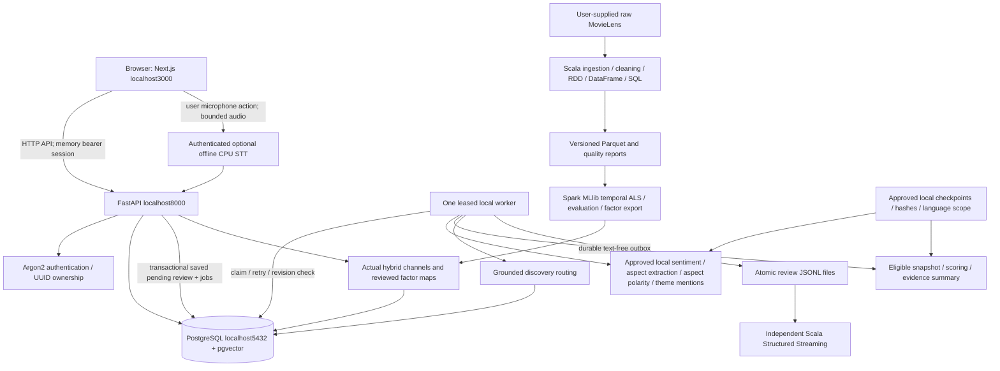
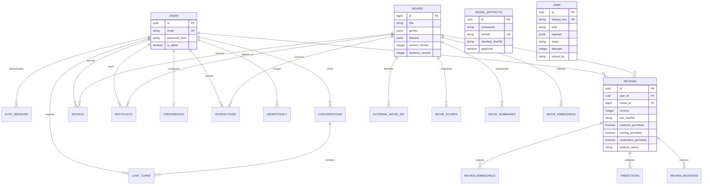

# Current source architecture and ER diagrams

Prepared 10 November 2026, Asia/Calcutta. These diagrams describe inspected
source, not a deployed system. The root [architecture](../../ARCHITECTURE.md)
and latest [status](../../IMPLEMENTATION_STATUS.md) remain authoritative. The
original architecture contains illustrative schemas; this ER diagram uses the
actual20 ORM entities in `backend/app/models/entities.py`.

## Components and trust boundaries



No cloud AI service, external broker or automatic dataset/model downloader is a
core dependency. The API/worker do not treat reviews as instructions. Exact
metadata filters use SQL; compatible vectors use pgvector; quoted evidence and
audience scores retain current revisions. All actual data/artifacts still need
their permission and runtime acceptance gates.

## Review lifecycle

```mermaid
sequenceDiagram
    actor User
    participant UI as Next.js
    participant API as FastAPI
    participant DB as PostgreSQL
    participant W as Single worker
    participant M as Approved local models
    User->>UI: Publish review with purpose choices
    UI->>API: Authenticated POST + Idempotency-Key
    API->>DB: Lock canonical movie; verify idempotency
    API->>DB: Insert original review/revision; invalidate snapshots; enqueue jobs
    API-->>UI: Saved review UUID, revision, pending
    UI->>API: Poll own saved review
    W->>DB: Claim eligible job with durable owner/attempt
    W->>M: Load and run one component at a time
    M-->>W: Actual outputs or explicit unavailable
    W->>DB: Recheck lease/current review revision/model approval
    W->>DB: Persist current predictions and queue refresh/outbox
    W->>DB: Publish eligible score/summary at current evidence version
    API-->>UI: Current saved status and available evidence
    User->>API: Edit/delete/withdraw permission
    API->>DB: Expected-revision/ownership check; invalidate derived evidence
    Note over W,DB: Older in-flight results must not overwrite a newer revision
```

The streaming view is asynchronous and can lag behind the DB while an edited
review is pending. Its source/sink/restart/reconciliation tests must be executed
before a delivery guarantee is asserted. Missing models never create a
hardcoded sentiment or a replacement audience score.

## Actual relational entities



The diagram abbreviates fields rather than reproducing the migration. Registry
versions in prediction/vector payloads are logical version references, not
fabricated relational foreign keys. Jobs store typed payload identities rather
than a relational edge for every job kind. Current genres/keywords/features are
JSONB on movies; no separate `genres`/`movie_genres` ORM tables are claimed.
The frozen SQL and models are the source of truth for constraints, indexes,
cascades, nullable values and vector dimensions.

## Data and measurement lineage

`raw source hash → approved canonical registry/permissions → frozen splits or
event snapshot → exact config/model/tokenizer hashes → genuine evaluation or
prediction report → reviewed policy/snapshot → API/UI → measured acceptance
record → curated evidence bundle`.

Keep the code revision plus dirty-source hashes. A Git commit alone is
insufficient when the demonstrated workspace contains later edits. Preserve
source-namespace IDs and reject conflicts rather than inventing a canonical map.
See [REPRODUCIBILITY.md](REPRODUCIBILITY.md) for the freeze record.
