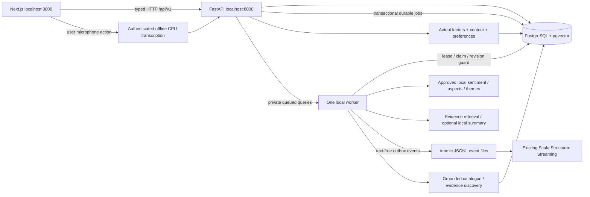

# Through-Phase11 source handoff

Updated 10 November 2026, Asia/Calcutta. The user will perform installations and
execution later. The current deliverable is connected source and static checks.
Phases12 and13 are explicitly deferred. Existing earlier data, model, Spark and
runtime acceptance gates remain open. No trained metric or running application
is implied by this document.

## 1. What connects to what



The browser never accesses PostgreSQL, model files or credentials. The API does
not load models during import. A bounded durable queue separates saved reviews
from expensive analysis. One PostgreSQL advisory-lock worker loads substantial
models sequentially and releases them between components. Default inference is
CPU; selecting CUDA later requires a new actual compatibility/resource check.

## 2. Phase9: backend and database

Objective: persist genuine canonical movies, application accounts, reviews,
permissions, predictions, score/summary snapshots and durable analysis jobs.

Source:

- `backend/app/api/routes`: auth, catalogue, reviews, profile, recommendations,
  administration and chat; all exposed under `/api/v1`.
- `backend/app/core`, `database`, `models`, `schemas`, `auth`, `repositories`,
  `services`, `workers`: separate configuration, persistence and application logic.
- `backend/alembic/schema_v1.sql` and revision `0001_initial.py`: frozen PostgreSQL
  schema with pgvector. No automatic startup migration or synthetic seed.
- `backend/manage.py`: explicit `--execute` administrator creation, licensed
  catalogue import and actual local embedding generation.
- `backend/prepare_embedding_artifact.py`: binds actual pretrained retrieval
  rankings, genuine human judgments and a reviewed study to a serving descriptor.
- `backend/.env.example`, serving/retrieval approval examples and operational
  PowerShell scripts. Examples deliberately grant no scientific approval.

The authentication implementation uses Argon2 password hashes and random opaque
bearer sessions, stored as SHA256 token hashes with expiry/revocation. There is
no default account or admin bypass. Browser credentials stay in memory and a
full refresh signs the user out. This local authentication choice does not need
a JWT signing secret. The earlier candidate PyJWT dependency remains preserved
in the existing manifest and is unused by these routes.

Review submission requires an authenticated owner and `Idempotency-Key`.
Retries with the same body return the same saved review; reusing a key with a
different body conflicts. Edits require `expected_revision`. Row locks refresh
the ORM identity before checking revision. Every accepted edit immediately
invalidates movie snapshots and deletes old prediction/vector records. A worker
must still match the current revision before publishing. Deletion scrubs stored
review text/revisions and invalidates derived evidence; model unlearning from
previous research exports/checkpoints is a separate consent/governance task.

Publishing, audience evidence, research training and moderation similarity checks
have separate flags. Personalization permission is separate again. Raw dataset
files are never modified by the application. Application UUIDs are separate
from MovieLens user identifiers. Canonical movies are imported only from an
approved internal registry; no title-based identity guessing is performed.

Only approved three-class domain models may serve overall sentiment. Binary
IMDb is rejected at promotion. Promotion checks the actual model manifest,
held-out report hashes, human decision and validated language scope. Both
extractor and target-sentiment model versions are attached to aspect outputs.
Model versions are globally unique across registry components. Manifest changes
invalidate loading. Do not edit registry approval directly in SQL; a complete
revocation/rebuild rehearsal is deferred, and the app has no revocation route.

Current scores require a reviewed policy and sufficient eligible current
evidence. They retain counts, effective sample size, method/model versions,
update time and available uncertainty intervals. No policy, model or evidence
produces a fabricated score. Empty evidence uses exactly
**"Not enough audience reviews yet."** Review stars and personalized match
scores remain distinct from audience sentiment.

The default summary is a bounded, sentiment/aspect-balanced set of quoted
extracts. Set `SUMMARIZATION_CONFIG` only to a reviewed local configuration to
generate hierarchical candidates on CPU. The admin candidate endpoint exposes
the candidate for factuality review; the public endpoint withholds novel text
until a matching human snapshot/candidate decision is approved. This optional
generation never downloads weights and never replaces database statistics.

Recommendations require genuine validation-selected hybrid weights. Explicit
genre/theme preferences, current ratings, semantic profiles and consented
watched/watchlist interactions feed actual channels. Non-rating interaction
weights require `interaction_weights_validated=true` and a reviewed
`interaction_weights` map in the selected hybrid config. They are ignored
otherwise. Missing ALS factors do not borrow a MovieLens identity. Optional
approved app-user fold-in uses actual item factors. Source online catalogue
processing is capped at5000 candidates; larger catalogues explicitly require a
prepared candidate strategy instead of silently truncating rankings.

## 3. Phase10: frontend

Objective: an original movie discovery/review product backed by actual APIs.
Brand: Framewise. Dark editorial layout, cached posters, responsive movie grids,
typed API client, accessible forms and honest missing-data states.

Pages: home, discovery/search, movie detail, authentication, watchlist, personal
recommendations, profile/preferences/review editing, assistant and transparency.
Reusable components separate movies, reviews, scores, recommendations, chat,
layout and shared loading/empty/error states. The evidence/AI summary is placed
above individual reviews on the movie detail page. Review analysis is polled
after durable submission; unavailable model coverage remains visible. Star
ratings and watched actions call real authenticated routes. Recommendation
explanations show actual matching preferences and channel contributions.

`frontend/package.json` pins the selected direct versions. A package-lock and
local node_modules appeared from the user's manual installation on10 November;
they were preserved. The successful TypeScript check does not validate a
production build, package integrity, browser rendering or runtime services.
No remote poster fetch, cloud AI provider or fabricated catalogue is used.

Only `NEXT_PUBLIC_API_BASE_URL` belongs in frontend public configuration.
Database passwords, model paths and admin tokens must never enter frontend
environment variables. The default API is `http://localhost:8000/api/v1`.

## 4. Phase11: discovery and optional offline voice

Objective: natural-language catalogue discovery with real evidence and bounded
private context. `discovery/parser.py` documents analytical English rules;
this is not a trained multilingual NLU claim. The mandatory multilingual review
models are separate from the query parser. Unsupported phrasing needs further
coverage and human evaluation, not a guessed language/model capability.

The routes support the required examples through explicit routing:

| Query | Source behavior |
|---|---|
| Recommend romance and science-fiction movies | Genre intersection SQL; actual hybrid personalization when available |
| Show movies similar to Interstellar | Exact catalogue entity resolution then compatible approved pgvector neighbours |
| How is Interstellar? | Actual metadata, audience score and current summary; missing evidence remains absent |
| What do people think about the soundtrack of Interstellar? | Current consented music-aspect evidence and source review revisions |
| Recommend something emotional but not too slow | Reviewed emotional-impact/pacing evidence threshold; otherwise explicit constraint-unavailable |
| Compare Arrival and Interstellar | Two resolved catalogue profiles; no invented comparative consensus |

Titles are resolved against actual names/year with ambiguity clarification.
Genre exclusion, runtime limits, controlled theme aliases and constrained
follow-ups are documented in parser source. Genre/theme/exclusion/runtime
context is bounded; conversations expire after24hours and accept at most40turns.
Delete the conversation to clear stored queries/replies. Reviews are treated as
data; template replies do not execute text instructions or invoke an unconstrained
language model. No arbitrary catalogue fact, consensus or score is generated.

Voice uses user-initiated browser recording, authenticated upload, optional
`faster-whisper==1.2.1`, a manually supplied CTranslate2 model and reviewed file
hashes. Inference is CPU int8 with two threads and no remote resolution. VAD is
off to avoid hidden auxiliary-model fetching. The browser records at most30sec;
server speech rejects over45sec and bounded text/body limits. Denied microphone,
unsupported codecs or absent dependencies/models return an explicit error while
text input remains usable. Audio is not persisted by this service. Actual codec,
WER, timing and offline behavior remain unmeasured. CPU speech does not require
changing the working PyTorch CUDA configuration. See the
[official release/runtime requirements](https://pypi.org/project/faster-whisper/1.2.1/).

## 5. Manual execution order after earlier gates are satisfied

These are future commands, not operations performed in this handoff. First
close the Phase1 permissions/mappings/annotations and Phase2 runtime gate;
execute approved experiments in Phases3–8 and record genuine results. Manually
install only reviewed missing dependencies from `PREREQUISITES.md`. Do not use
generated source as evidence of trained model quality.

1. Reinspect versions, selected Python, CUDA, RAM and disk. Prepare the native
   PostgreSQL/pgvector server and review the migration in an isolated database.
2. Manually create a local application role/database with a user-chosen password
   and enable pgvector with an appropriate administrator. Keep role privileges
   local. Never put the password in a command argument or committed SQL file.
   Copy `backend/.env.example` to a new `backend/.env` only if none exists and
   fill your own settings. No script changes global Java/CUDA/PATH.
3. Run metadata preflight `scripts/setup_database.ps1`; review its results.
   Only after approving the DB action use `-ExecuteMigration`. No automatic
   database creation/reset, seed or fallback SQLite exists.
4. Use the following explicit commands for genuine catalogue/account data:

   ```powershell
   .\.venv\Scripts\python.exe -m backend.manage create-admin --execute
   .\.venv\Scripts\python.exe -m backend.manage import-catalogue --registry data/processed/ids/approved_registry.json --input data/processed/metadata/licensed_catalogue.jsonl --execute
   ```

   Paths above are operator-selected future inputs, not files claimed present.
   Catalogue records require `movie_id,title,metadata_source`, explicit
   `metadata_use_permitted:true` and `license_reference`; optional synopsis,
   genres, keywords, runtime, language, artwork path, external IDs and curated
   themes are imported as supplied. Existing IDs are never overwritten. Review
   external IDs/provenance independently and retain the source permission record.
   Nonempty external IDs also require `external_mappings_approved:true` and
   `external_mapping_reference`. IMDb identifiers must be strings so leading
   zeros survive; only reviewed imdb/tmdb/movielens namespaces are accepted.
   Stored IMDb keys use the `tt` prefix consistently, preserving every digit;
   raw supplied metadata stays unchanged and its import hash is retained.
5. Freeze actual trained/evaluated artifacts and serving decisions. Start the
   API deliberately to register them using authenticated admin routes in
   `/docs`; `/admin/models` accepts component, globally unique version, config,
   run, approval-reference and validated language scope. A pretrained embedding
   experiment uses `backend.prepare_embedding_artifact` with local config,
   rankings/judgments/study/output paths; its evaluation consumes real rankings,
   not model-supplied metrics. Make a reviewed serving decision afterward.
6. Generate actual catalogue embeddings with `backend.manage embed-catalogue
   --config <approved-config> --model-version <registered-version> --execute`.
   Prepare actual Scala factors/maps and validated hybrid/scoring policies;
   update private configuration to their reviewed paths.
7. Manually prepare `frontend/.env.local` if needed without replacing an existing
   file. For static type checking use the installed local compiler. Production
   builds are later manual actions; startup scripts never run installation or
   build commands.
8. Start PostgreSQL manually, then start API/one worker/frontend in separate
   terminals using `scripts/start_backend.ps1 -Run`, `start_worker.ps1 -Run`
   and `start_frontend.ps1 -Run`. Alternatively `start_all.ps1 -Run` launches
   hidden owned processes, waits for schema readiness and records their PID,
   executable and creation time under `artifacts/services/<run>/processes.json`.
   It does not start PostgreSQL, Spark, Jupyter or training. Default script
   invocation without `-Run` performs preflight only.
9. Read liveness `/api/v1/health`, DB/schema readiness `/api/v1/ready`, and
   authenticated admin pipeline/model status separately. Use existing
   `scripts/check_health.ps1` for localhost checks. Readiness does not establish
   that every model is approved or that inference works.
   To check schema readiness with that existing checker, explicitly use
   `-BackendUrl http://127.0.0.1:8000/api/v1/ready`; its default health endpoint
   intentionally supplies liveness only and reports readiness as unverified.
10. Stop only verified owned children with `scripts/stop_all.ps1 -ProcessRecord
    <actual-record> -Run`. It does not kill all Python/Node processes, remove
    logs, stop PostgreSQL or delete user files.

Expected addresses: frontend localhost3000; API localhost8000 and `/docs`;
PostgreSQL localhost5432; optional Jupyter8888; Spark UI4040 during a real job.
No service has been started by this generation delivery.

## 6. Contracts and remaining acceptance

The API uses string canonical movie IDs for browser responses, application UUIDs
for accounts/reviews and explicit revision numbers. Original Unicode spans remain
code-point offsets; frontend currently renders provided aspect labels/text and
does not reinterpret offsets as JavaScript UTF16 indices. Stored embeddings
retain dimension, content version and registered model version; cosine searches
never mix dimensions or revisions. Variable-dimension pgvector columns use exact
search; an ANN index needs a separately measured fixed-dimension strategy.

The outbox exports text-free actual sentiment probabilities or a deletion event
as atomic replay-safe files. DB UI snapshots invalidate immediately on edits.
Streaming may retain old evidence until the new analysis/deletion event arrives;
pending edits with unavailable models need explicit reconciliation during later
execution. Event IDs are stable by review/revision and duplicate publications
must match bytes. This is not a proven end-to-end exactly-once claim.

Theme mention/relevance predictions, curated catalogue themes and theme-specific
audience polarity remain distinct. No target polarity is copied from overall
sentiment. Topic exploration, theme/genre reception evaluation and policy
approval remain earlier scientific acceptance tasks; absent approved target
evidence is not filled by the UI. No recommendation quality, fake-review accuracy,
multilingual coverage or summary factuality metric is currently established.

Checklists for execution, all still open:

- Phase9: real migrations/constraints, authenticated ownership/idempotency,
  revision races, worker crash/retry, model admission, deletion/consent export
  reconciliation, vector queries and event replay.
- Phase10: manual production build, real browser/API journey, keyboard/mobile
  layouts, authenticated state changes, private error handling, artwork rights.
- Phase11: six query examples with actual catalogue/evidence, ambiguity, retained
  constraints/context expiry, semantic/hybrid retrieval and offline speech.
- Phase12/13: deferred to the user. Previously generated test/final-document
  drafts are retained unexecuted; they are not a finished evaluation package.

Use `IMPLEMENTATION_STATUS.md` and the generated static-check artifacts for
observed evidence. No unit, DB, model, Spark, browser or load test ran here.
